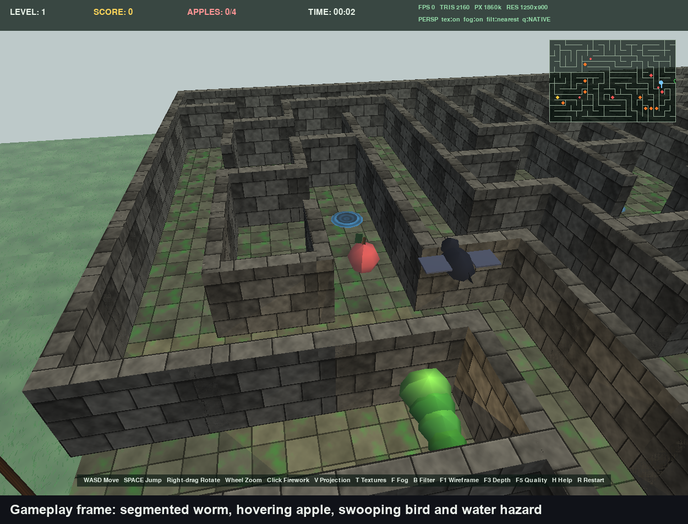

# Worm's Garden Adventure 3D

A complete conversion of a 2D grid game into a **software-rendered 3D game** written
with Python, NumPy and Pygame only. There is no OpenGL and no game engine: every
stage of the pipeline (matrices, camera, clipping, back-face culling, triangle
rasterization, z-buffer, lighting, texture mapping, particles, optimizations) is
implemented in this repository.

This is the submission for **Lab 10 + Lab 11 (GEIAL31L-B2a, Part A + Part B)**.
Lab 10 and Lab 11 are two parts of **one** assignment: one code base, one set of
screenshots, **one English technical report**.



## 1. What is in the repository

| Path | Purpose |
|---|---|
| `game3d.py` | Game code: maze, player/worm, apples, birds, water hazards, camera rig, HUD, levels, animation, particles |
| `engine3d.py` | Software 3D renderer: `Mat4`, `Camera`, projections, clipping, rasterizer, z-buffer, lighting, textures, fog, bilinear filter, debug views |
| `textures.py` | Procedural textures generated at start-up (Pillow), so the repository ships no binary art |
| `tests/test_pipeline.py` | 17 numerical unit tests (transforms, projection, jump, collision, z-buffer, clipping, filtering) |
| `tools/capture_screenshots.py` | Headless renderer used to produce all evidence screenshots |
| `tools/benchmark.py` | Measures the four quality presets and the extension overhead |
| `tools/render_video.py` | Renders the scripted 2–4 minute demo video |
| `screenshots/` | Evidence images required by the handbook |
| `docs/` | Technical report (`Technical_Report_Lab10_11.docx` / `.pdf`), performance data |
| `demo_video.mp4` | 2–4 minute screen recording of the game |

## 2. Requirements

* Python 3.11 or newer (tested on CPython 3.13)
* `numpy`, `pygame`, `Pillow`, `python-docx` (only for regenerating the report)

```bash
python -m pip install -r requirements.txt
```

## 3. Run the game

```bash
python game3d.py
```

No assets are loaded from disk; the window starts at 1250×900, can be resized or
maximised freely (the framebuffer follows the window size and keeps its aspect
ratio), and the internal framebuffer resolution is cycled with F5.

### Controls

| Key | Action |
|---|---|
| W A S D / arrows | Move (camera-relative) |
| Space | Physical jump (initial vertical velocity + gravity) |
| Right mouse drag | Rotate the orbit camera |
| Mouse wheel | Zoom |
| Left click | Place a 3D firework (particle burst + point light) |
| V or P | Toggle perspective / orthographic projection |
| T | Toggle textures |
| **F** | **Extension 1: depth fog on/off** |
| **B** | **Extension 2: bilinear filtering on/off** |
| F1 / G | Wireframe overlay |
| F3 | Z-buffer visualisation |
| F5 | Cycle FAST / BALANCED / HIGH / NATIVE |
| C | Sharpening (unsharp mask) before upscaling on/off |
| F11 | Fullscreen / windowed |
| H | Help panel (math notes) |
| R | Restart level |
| Esc / Q | Quit |

## 4. Part A checklist (handbook Section 16.1)

| Requirement | Where it is implemented | Evidence |
|---|---|---|
| World coordinates in 3D, ground plane, walls, worm, apples, birds, water, flags | `game3d.py` build_level / draw_* | `01_perspective_full.png` |
| Arbitrary camera + presets + perspective/orthographic | `Camera`, `update_camera`, V/P | `01`, `02` |
| Correct occlusion (z-buffer) | `Renderer._rasterize` | `04`, `05` |
| Ambient + diffuse lighting, Pillow texture | `Renderer` lighting, `textures.py` | `01`, `06` |
| Maze generation, collision, jump, hazards, apples, score, timer, levels | `Maze`, `move_player`, `check_hazards` | `06` |
| 3D animation and 3D particles | flags, water ripples, worm segments, wings; `Particle` billboards | `06`, video |
| Numerical tests, screenshots, performance table, resize/aspect test | `tests/`, `tools/` | `11`, `12`, `docs/performance.md` |
| Math explanation of every stage | `docs/Technical_Report_Lab10_11.pdf` | report Sections 3–8 |

## 5. Part B extensions (30 marks)

**Extension 1 – depth fog (graphics).** Per-fragment blend towards the fog colour
with `f = 1 - exp(-(density * depth)^2)`, computed from the interpolated
perspective-correct view depth. Toggle with **F**. Before/after:
`screenshots/07_extension1_fog_on.png` vs `08_extension1_fog_off.png`.

**Extension 2 – bilinear texture filtering (image processing).** Nearest-neighbour
sampling is replaced by a 2×2 texel fetch with bilinear weights and power-of-two
wrapping. Toggle with **B**. Before/after:
`screenshots/09_extension2_nearest.png` vs `10_extension2_bilinear.png`.

Both extensions are original code written for this project, not library features.

## 6. Tests and measurements

```bash
python -m unittest discover -s tests -v      # 17 numerical tests
python tools/capture_screenshots.py          # regenerate screenshots (headless)
python tools/benchmark.py                    # regenerate performance tables
python tools/render_video.py                 # regenerate demo_video.mp4
```

## 7. Notes

* World scale: one grid cell is 50 world units (`CELL = 50`), walls are 40 units
  high and 8 units thick, the maze is 23×15 cells.
* The game runs at ~10–45 FPS depending on the quality preset; this is expected
  for a pure NumPy rasterizer and is documented in the report.
* The report uses English throughout, as required.
